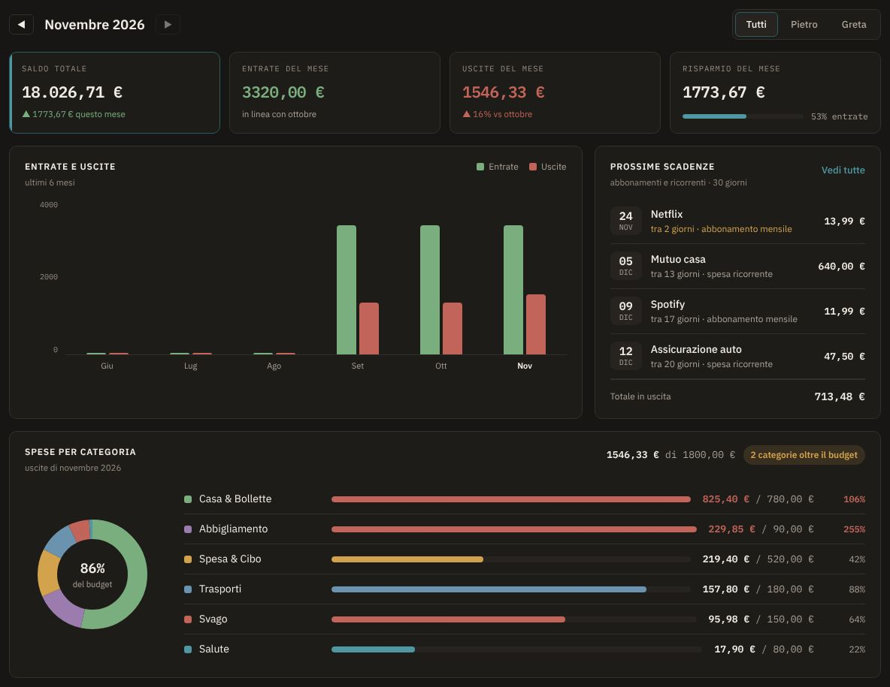
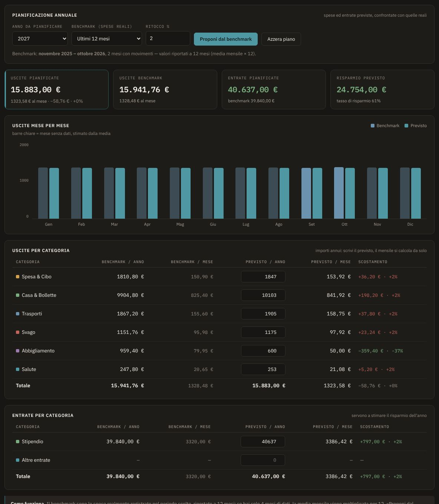
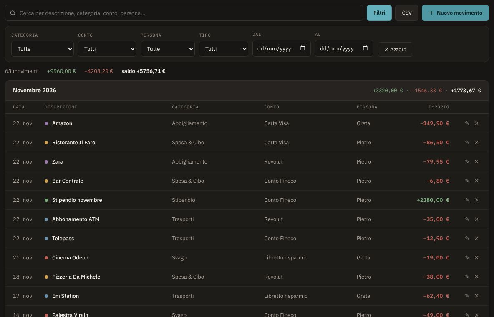
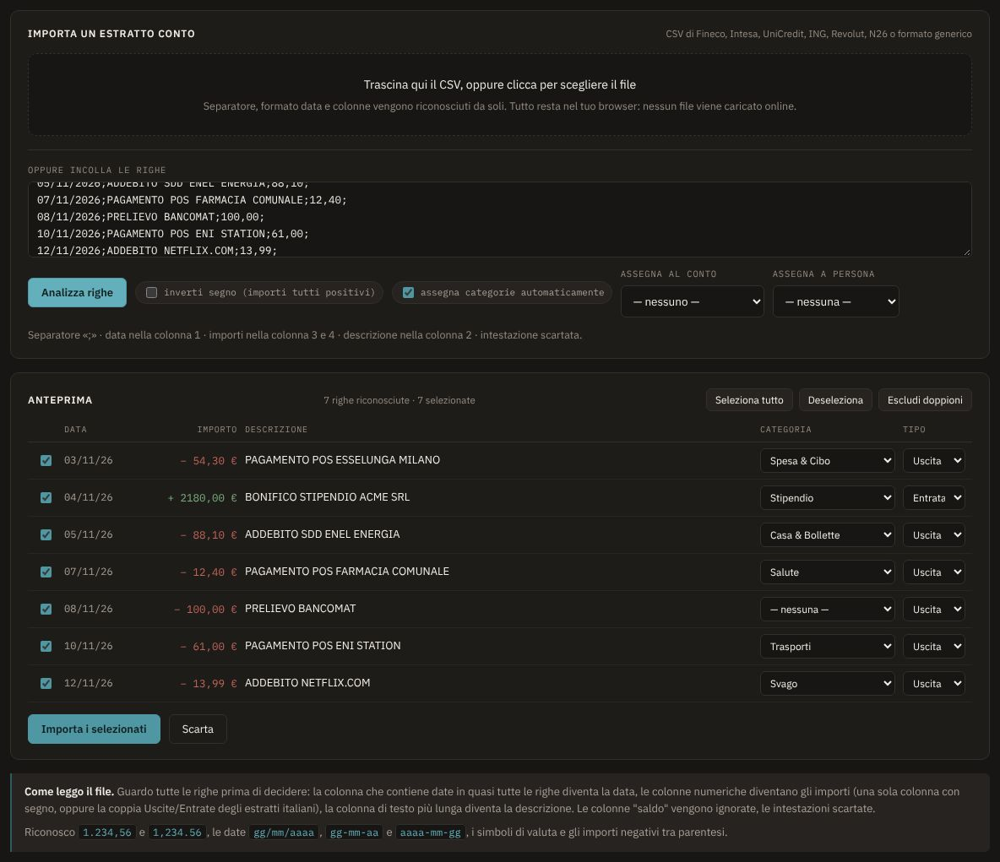
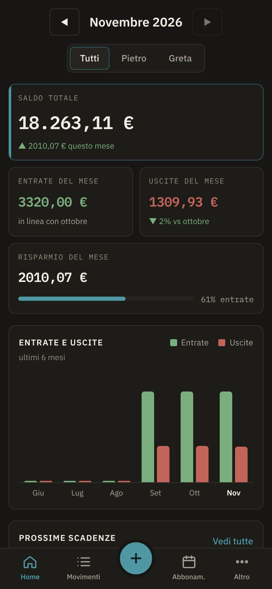
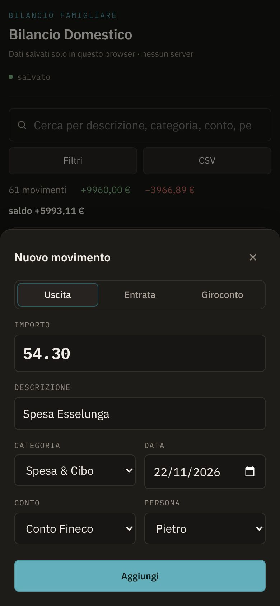

# Dashboard Finanziaria Light

App di gestione finanze personali in un **unico file HTML**, senza backend: dashboard, movimenti, budget per categoria, pianificazione annuale, abbonamenti, conti e carte di credito, obiettivi di risparmio, investimenti e import di estratti conto CSV, con un tutorial integrato. I dati restano sempre e solo nel browser di chi la usa (`localStorage`) — niente server, niente database, niente account.

**➡️ Usala qui: https://jackills93.github.io/Dashboard-Finanziaria-Light/**

Versione "leggera" e standalone di [Personal-Finance](https://github.com/Jackills93/Personal-Finance): stesso modello di dati e stesso spirito, ma pensata per essere aperta, installata sul telefono o mandata a qualcuno senza dover configurare nulla.

---

## Indice

- [Funzionalità](#funzionalità)
- [Screenshot](#screenshot)
- [Pianificazione annuale](#pianificazione-annuale)
- [Help e tutorial](#help-e-tutorial)
- [Installarla sul telefono](#installarla-sul-telefono)
- [Importare un estratto conto](#importare-un-estratto-conto)
- [Backup e trasferimento dei dati](#backup-e-trasferimento-dei-dati)
- [Configurare il bot Telegram](#configurare-il-bot-telegram)
- [Sviluppo e hosting](#sviluppo-e-hosting)
- [Limiti da conoscere](#limiti-da-conoscere)

---

## Funzionalità

- **Dashboard** — saldo con variazione del mese, entrate/uscite a confronto col mese precedente, risparmio del mese, barre entrate/uscite degli ultimi 6 mesi, prossime scadenze (abbonamenti e ricorrenti a 30 giorni), spese per categoria con ciambella e budget
- **Movimenti** — lista raggruppata per mese (e per giorno su mobile) con totali, ricerca, filtri a scomparsa, export CSV; inserimento e modifica in un pannello laterale
- **Navigazione mobile** — barra in basso (Home, Movimenti, +, Abbonamenti, Altro) con il pulsante "+" sempre a portata di pollice
- **Budget** — categorie con limite mensile, spese e entrate ricorrenti generate da sole ogni mese
- **Pianificazione** — spese ed entrate previste per l'anno, categoria per categoria, confrontate con quelle reali (benchmark) e, durante l'anno, con l'andamento effettivo (vedi sotto)
- **Abbonamenti** — periodicità mensile o annuale, rinnovo automatico alla scadenza (con uscita registrata tra i movimenti) finché non li elimini, costo mensile/annuo complessivo e promemoria Telegram 3 giorni prima del rinnovo
- **Conti** — saldo calcolato da saldo iniziale + movimenti, multi-conto, giroconti
- **Carte di credito** — plafond, utilizzato e disponibile; nel giorno di addebito il debito del mese precedente viene saldato con un giroconto automatico dal conto scelto
- **Obiettivi di risparmio** — target, scadenza, versamenti
- **Investimenti** — posizioni con P&L e allocazione per tipo di strumento
- **Tema e colori** — 5 temi pronti (Originale, Chiaro, Notte blu, Foresta, Prugna) o colori personalizzati per sfondo, pannelli, testo, accento e stati; preferenza salvata sul dispositivo, il report PDF resta chiaro
- **Import CSV** — riconosce da solo separatore, formato data, colonna importi (anche il formato a due colonne Uscite/Entrate degli estratti italiani) e propone una categoria per ogni riga
- **Bot Telegram** — registra spese scrivendo un messaggio al bot (vedi sotto)
- **PWA installabile** — icona sulla schermata Home, funziona offline dopo la prima visita
- **Help** — tutorial passo per passo con screenshot, dentro l'app (scheda **Help**, su telefono in **Altro**)

---

## Screenshot

| Dashboard | Pianificazione |
|---|---|
|  |  |

| Movimenti | Import CSV |
|---|---|
|  |  |

| Telefono | Nuovo movimento |
|---|---|
|  |  |

Le stesse immagini compaiono nel tutorial dentro l'app. Sono generate con i dati di esempio.

---

## Pianificazione annuale

La scheda **Pianificazione** serve a decidere quanto spendere l'anno prossimo partendo da quanto hai speso davvero.

1. Scegli l'**anno da pianificare** (di default il prossimo) e il **benchmark**: gli ultimi 12 mesi conclusi oppure un anno intero di movimenti reali.
2. **Proponi dal benchmark** riempie il piano: per ogni categoria la spesa reale annua più un **ritocco %** (per esempio l'inflazione prevista).
3. Correggi le singole categorie nella colonna **Previsto / anno**. Per ognuna vedi il mensile, lo scostamento dal benchmark in euro e percentuale, e i totali.
4. I riquadri in alto riassumono uscite pianificate, uscite del benchmark, entrate pianificate e **risparmio previsto** con il tasso di risparmio.
5. Il grafico **Uscite mese per mese** mette a confronto, mese per mese, il benchmark e il piano.

Quando l'anno pianificato arriva compare la colonna **Reale**: una barra mostra quanto hai già speso rispetto al piano, con una tacca che indica dove dovresti essere a quella data. La barra diventa gialla se vai più veloce del previsto e rossa se superi il piano.

Se hai meno di 12 mesi di dati, il benchmark usa la **media mensile × 12**. Nel grafico i mesi senza dati sono stimati dalla media e mostrati più chiari. I piani sono inclusi nel backup; con **Unisci** gli anni già pianificati non vengono sovrascritti.

---

## Help e tutorial

La scheda **Help** (su telefono: **Altro → Help e tutorial**) spiega l'app in 10 argomenti, ognuno con i passaggi e uno screenshot: primi passi, registrare un movimento, cercare e filtrare, importare un estratto conto, budget e ricorrenti, pianificazione, abbonamenti, conti e carte di credito, backup/tema/Telegram, uso sul telefono.

Le immagini stanno nella cartella `help/` accanto a `index.html`. Se apri il solo file HTML senza la cartella, il tutorial resta leggibile e le immagini vengono semplicemente omesse.

---

## Installarla sul telefono

**iPhone (Safari):** tocca l'icona di condivisione `⬆` nella barra in basso → **Aggiungi a Home**. Su iPhone non è solo comodità: Safari cancella i dati dei siti visitati raramente dopo 7 giorni, ma le pagine aggiunte a Home ne sono esenti.

**Android (Chrome):** compare da solo il pulsante **⤓ Installa** in alto nell'app; in alternativa, menu `⋮` → **Installa app**.

---

## Importare un estratto conto

Dalla scheda **Importa**: trascina un file CSV o incolla le righe copiate dal tuo home banking. Funziona con Fineco, Intesa, UniCredit, ING, Revolut, N26 e formati generici — il riconoscimento delle colonne è automatico, ma la scheda ti fa vedere un'anteprima prima di confermare, con la possibilità di correggere categoria e tipo riga per riga.

---

## Backup e trasferimento dei dati

I dati vivono solo nel browser che stai usando. Dalla scheda **Impostazioni**:

- **Genera backup** → copia negli appunti o scarica un file `.json` con tutto il bilancio
- **Ripristina** → incolla o carica un backup per recuperarlo (anche su un altro dispositivo)
- **Unisci** invece di sostituire, se vuoi sommare i dati di due backup

Fai un backup ogni tanto, e sempre prima di cambiare dispositivo o svuotare i dati del browser.

---

## Configurare il bot Telegram

Il bot permette di registrare un movimento scrivendo un messaggio, es. `25,50 Spesa Coop #Alimentari`. Funziona **interamente dal browser**, senza server: la pagina interroga direttamente le API di Telegram finché resta aperta (o quando premi "Sincronizza ora").

### 1. Crea il bot

1. Apri Telegram e cerca **@BotFather**
2. Scrivigli `/newbot` e segui le istruzioni (nome e username del bot)
3. BotFather ti restituisce un **token**, una stringa tipo `123456789:AAExxxxxxxxxxxxxxxxxxxxxxxxxxxxxxxxx` — copialo, ti serve al passo 3

### 2. Se il bot ha già un webhook attivo, disattivalo

Se hai già usato questo bot con un backend (come il progetto Personal-Finance completo), Telegram gli sta ancora inviando i messaggi via webhook — e finché è attivo, il browser non può leggerli.

1. Nella dashboard, vai su **Impostazioni** → pannello **Bot Telegram**
2. Incolla il token nel campo **Token del bot**
3. Premi **Disattiva webhook**

Da quel momento il vecchio backend smette di ricevere messaggi: webhook e lettura da browser sono alternativi, non possono coesistere.

### 3. Collega il bot alla dashboard

1. Sempre nel pannello **Bot Telegram**, con il token già inserito, premi **Verifica bot** — deve confermarti username e che è raggiungibile
2. Scegli il **Conto predefinito** su cui registrare le spese che arrivano da Telegram
3. Apri una chat col tuo bot su Telegram e scrivigli qualcosa, es. `/start`
4. Torna nella dashboard e premi **Sincronizza ora** — il messaggio diventa un movimento

Se vuoi che controlli da sola i nuovi messaggi ogni minuto, spunta **"sincronizza ogni 60 secondi mentre la pagina è aperta"** — vale solo finché tieni quella scheda aperta nel browser.

### Sintassi dei messaggi

```
25,50 Spesa Coop                        → uscita, categoria indovinata dalla descrizione
25,50 Spesa Coop #Alimentari            → categoria esplicita
25,50 Spesa Coop #Alimentari #Fineco    → categoria e conto
+1850 Stipendio                         → entrata (il + davanti all'importo)
```

La persona viene riconosciuta dal nome Telegram di chi scrive, se coincide con una di quelle inserite nella dashboard (scheda **Conti**).

### Promemoria abbonamenti

3 giorni prima del rinnovo di un abbonamento il bot ti manda un messaggio su Telegram (uno solo per ogni scadenza).

1. Scrivi `/start` al bot e premi **Sincronizza ora**: il **Chat ID** nel pannello Bot Telegram si compila da solo (oppure inseriscilo a mano)
2. Lascia spuntato **avvisa 3 giorni prima del rinnovo** e premi **Invia prova** per verificare
3. In qualunque momento puoi scrivere `/abbonamenti` al bot per l'elenco dei prossimi rinnovi

Come la lettura dei messaggi, anche l'invio parte **solo quando la dashboard è aperta** (all'apertura, al rientro nella scheda e ogni 30 minuti): basta aprirla almeno una volta nei 3 giorni prima della scadenza.

### Sicurezza del token

Il token dà il controllo completo del bot. Resta salvato solo nel tuo browser, ma **chiunque apra questa pagina sul tuo dispositivo lo può leggere** — non inserirlo mai in una copia della dashboard che condividi con altri. Se sospetti che sia stato esposto, revocalo su BotFather con `/revoke`.

### Perché non un webhook come nel progetto completo

Un webhook richiede un server pubblico che riceva le chiamate di Telegram in tempo reale — qui non c'è, per design: questa versione è pensata per girare da un file statico, senza infrastruttura da mantenere. Il compromesso è che i messaggi si leggono solo quando apri la pagina (o quando la tieni aperta con la sincronizzazione automatica attiva), non nell'istante in cui li scrivi. I messaggi restano in coda sui server di Telegram per ~24 ore, quindi basta riaprire la dashboard entro quella finestra per non perderne nessuno.

---

## Sviluppo e hosting

Nessuna build, nessuna dipendenza da installare:

```
index.html   — l'intera app (HTML, CSS, JavaScript)
sw.js        — service worker per l'uso offline e l'installazione come PWA
help/        — screenshot del tutorial (facoltativi: senza, l'app funziona lo stesso)
```

Vanno tenuti nella stessa cartella su qualunque hosting statico (GitHub Pages, come qui, oppure Vercel, Netlify, ecc.). In locale basta scaricarli e aprire `index.html` col browser: funziona anche senza server, con l'unica differenza che il service worker non si registra da `file://` (nessun errore, solo niente cache offline).

Gli screenshot in `help/` si rigenerano con i dati di esempio (finestra 1200 px per il desktop, 390 px per il telefono): se cambi l'aspetto di una schermata, aggiorna anche la sua immagine.

## Limiti da conoscere

- **Un solo bilancio per origine.** I dati sono legati all'indirizzo da cui apri la pagina: la stessa persona che apre due copie diverse del file in locale (`file://`) le vede come un unico bilancio condiviso, perché usano la stessa chiave di salvataggio.
- **Niente sincronizzazione tra dispositivi.** Il bilancio aperto sul telefono e quello sul computer sono due bilanci separati, a meno di passarsi un backup a mano.
- **Bot Telegram solo a pagina aperta** (o con sincronizzazione ogni 60 secondi attiva) — non è un servizio sempre acceso. Vale anche per i promemoria degli abbonamenti.
